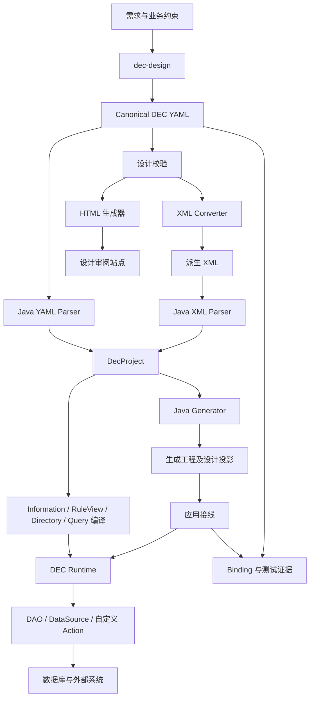

# 整体架构

[返回文档总览](README.md)

## 1. 从需求到可运行应用

Skill 是开发期工作契约和工具集，Java 框架是执行期能力。部署后的应用不会在每个请求中调用 Skill 或让模型重新生成业务代码。

## 2. 四个协作层

| 层 | 组成 | 职责 |
| --- | --- | --- |
| 设计层 | `dec-design`、canonical YAML、规范、验证器 | 维护模型、事实、流程、API 和逻辑数据源 |
| 框架层 | `dec-java-lite` | 解析同一设计、编译计划、执行 Runtime、生成类型与接口 |
| 应用层 | 生成骨架 + 手写绑定 | 实现事务接入、DAO、第三方适配、模型转换、错误映射 |
| 证据层 | `dec-implementation`、Binding、JUnit 报告 | 证明设计节点被谁实现、哪些用例实际运行、证据是否对应当前版本 |

HTML、设计索引和生成的 Information/Flow 类提供跨层导航；它们不是另一套可独立修改的业务定义。

## 3. Java 模块地图

所有模块位于 [dec-java-lite](../dec-java-lite)。

| 模块 | 主要职责 |
| --- | --- |
| `dec-lite-core` | canonical AST、模型、ID、语义摘要与公共错误类型 |
| `dec-lite-parser` | YAML/XML 前端、输入安全、classpath 资源清单加载 |
| `dec-lite-information` | Information 编译、依赖图、识别、物化、失效与 RuleView 注册边界 |
| `dec-lite-action` | RuleView 编译执行、DSL、自定义 Action、监听器、外部操作分派 |
| `dec-lite-session` | 执行会话、模型工作区、事务资源和作用域 |
| `dec-lite-directory` | 流程图编译、前进/case/Back、WorkflowRunner、显式事务模式 |
| `dec-lite-query` | 阶段查询规划、SQL 转换、JDBC 执行、View 装配与 Information 过滤 |
| `dec-lite-spring` | Spring 外部托管或 Runtime 自管事务的明确桥接 |
| `dec-lite-generator` | 生成模型、接口、配置、设计投影、索引和产物清单 |
| `dec-lite-cli` | inspect、generate、information、action、directory、query 等命令 |

模块按功能分层，表格不是严格的 Maven 依赖拓扑。精确依赖以各模块 POM 为准。

## 4. 启动时编译，请求时隔离执行

Demo 启动时通过 `DecXmlParser.parseClasspath(..., "dec/design-files.txt")` 加载打包的 XML，构建可复用的 `DirectoryWorkflowRunner`。查询服务另构建 `BusinessQueryRuntime`。它们保存编译结果，避免每次请求重复解析和编译设计。

请求执行时创建/绑定该请求的模型、适配器、RuleView 注册表、Information 求值环境、payload 和事务作用域。共享的是不可变设计与编译结果；不能让一个请求的模型或求值缓存污染另一个请求。

框架另有 `RuntimeCatalog` 的候选版本校验及快照替换机制。现有 Demo 并未自动监听文件热更新；修改设计后须重新生成、打包并重建 Runner。不要将框架具有的热替换接口误写成 Demo 已启用的功能。

## 5. 一次业务命令的生命周期

以支付结果回调为例：

1. 生成的 Controller 接收并校验传输参数，调用 Service 接口。
2. 手写 ServiceImpl 委托 `OrderWorkflow`；Spring 开启应用事务。
3. Store/DAO 锁定并读取订单聚合，Assembler 与 ModelCodec 转换为 Runtime 模型。
4. Runtime 识别已有 Directory、校验可推进路径、绑定数据源和监听器。
5. 执行接收结果 Action，按设计识别 case，再执行 success 或 error 分支 Action/Change。
6. 完成回调持久化最终模型、重新读取并按 canonical Information 核对结果。
7. 事务所有者提交；已注册的提交后动作随后执行。

步骤 6 必须早于物理提交。`after(Action)` 也仍在提交之前；它不是 `afterCommit`。

## 6. 一次业务查询的生命周期

`find("订单").start("已订购").end("支付成功")` 先解析别名到 View/Directory，再按图选择阶段，编译查询计划。SQL 负责可安全下推的条件和关系读取，剩余 Information 条件由 Runtime 识别。

执行器先确定不同的根记录，再读取完整关系并装配 View，防止一对多 JOIN 导致订单分页失真。查询具有候选上限；不能完成请求页时明确失败，不能静默给出不完整结果。

命令和查询共享设计含义，但查询不会执行 Action、Change 或 Back。详见 [Java 框架](java-framework.md) 和 [示例查询](order-payment-demo.md#7-业务查询示例)。

## 7. 资源和事务边界

设计 DataSource 是逻辑外部能力，可能代表数据库、支付平台、消息或其他服务。Java 的 `javax.sql.DataSource` 只是 JDBC 资源，二者不能混为一谈。

流程可以声明默认逻辑 DataSource，Action 可以覆盖；实际适配器由应用注册并按执行选择。路由选择不等于跨数据源原子事务，也不会自动替换所有应用 DAO 的连接。当前框架不承诺 XA，短信可靠投递需独立机制。
