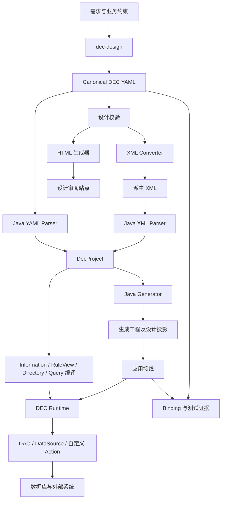

# 整体架构

[返回文档总览](README.md)

如果把订单支付 Demo 当作一条从设计走到请求的链路，仓库里的几个目录就比较容易理解：`dec-design` 负责把业务说清楚，`dec-java-lite` 负责读懂并执行这份设计，Demo 负责接上数据库和外部服务，`dec-implementation` 负责记录“哪些设计已经由什么代码和测试实现”。

## 1. 从一条规则到一次请求

下面以“支付结果回调”为例。业务设计先保存在 canonical YAML 中，然后由工具生成 XML 和 HTML；Java 框架读取同一份设计，应用再把它接到真实资源上。

Skill 是开发时使用的工具和工作约定；Java 框架是应用运行时使用的能力。应用启动后不会在每个请求中重新调用 Skill，也不会让模型临时生成一套业务代码。

## 2. 四个协作层

| 层 | 在仓库中的位置 | 主要回答的问题 |
| --- | --- | --- |
| 设计层 | `dec-design`、canonical YAML、规范和校验器 | 业务数据、事实、流程和 API 到底是什么？ |
| 框架层 | `dec-java-lite` | 怎样解析设计、编译规则并执行流程？ |
| 应用层 | 生成骨架和手写绑定 | 怎样连接数据库、事务和第三方服务？ |
| 证据层 | `dec-implementation`、Binding、测试报告 | 哪些节点已经实现，证据是否对应当前版本？ |

HTML、设计索引和生成的 Information/Flow 类是这些层之间的导航。它们帮助人阅读和定位，不应被当成另一份可以独立修改的业务定义。

## 3. Java 模块地图

所有模块位于 [dec-java-lite](../../dec-java-lite)。可以先按下面的用途找模块；具体 Maven 依赖仍以各模块 POM 为准。

| 模块 | 主要职责 |
| --- | --- |
| `dec-lite-core` | canonical AST、模型、ID、语义摘要与公共错误类型 |
| `dec-lite-parser` | YAML/XML 前端、输入安全和 classpath 资源清单加载 |
| `dec-lite-information` | Information 编译、依赖图、识别和物化 |
| `dec-lite-action` | RuleView、DSL、自定义 Action、监听器和外部操作分派 |
| `dec-lite-session` | 执行会话、模型工作区、事务资源和作用域 |
| `dec-lite-directory` | 流程编译、前进/case/Back、WorkflowRunner 和事务模式 |
| `dec-lite-query` | 阶段查询、SQL 转换、JDBC 执行、View 装配和过滤 |
| `dec-lite-spring` | Spring 托管事务与 Runtime 事务之间的桥接 |
| `dec-lite-generator` | 生成模型、接口、配置、设计索引和产物清单 |
| `dec-lite-cli` | `inspect`、`generate`、`information`、`action`、`directory`、`query` 等命令 |

## 4. 启动时编译，请求时隔离

Demo 启动时通过 `new DecXmlParser().parseClasspath(classLoader, "dec/design-files.txt")` 读取打包的 XML，并构建可复用的 `DirectoryWorkflowRunner`；查询服务另行构建 `BusinessQueryRuntime`。这样做的目的很实际：设计只编译一次，请求不必反复解析文件。

每次请求仍然创建自己的模型、适配器、RuleView 注册表、Information 求值环境、payload 和事务作用域。共享的是不可变的设计和编译结果，不能让一个请求的模型或缓存跑到另一个请求里。

框架提供 `RuntimeCatalog` 的候选版本校验和快照替换机制，但当前 Demo 没有自动监听文件变化。改完设计后，要重新生成、打包并重建 Runner；不要把框架存在热替换接口写成 Demo 已经启用热更新。

## 5. 支付结果回调怎样走完

一次 `receivePaymentResult` 请求大致经过这些步骤：

1. 生成的 Controller 校验请求参数，调用 Service。
2. 手写 ServiceImpl 把请求交给 `OrderWorkflow`，Spring 开启应用事务。
3. Store/DAO 读取并锁定订单，Assembler 将数据转换成 Runtime 模型。
4. Runtime 识别当前 Directory，检查依赖、数据源和监听器。
5. 执行接收结果 Action，根据成功或失败条件进入相应分支，并执行 Change。
6. 完成回调保存最终模型，再从 DAO 读回，按 canonical Information 检查结果。
7. 事务所有者提交；登记的提交后动作随后执行。

第 6 步必须发生在物理提交之前。`after(Action)` 表示动作成功，但仍在提交前；只有 `afterCommit` 才表示数据库已经提交。

## 6. 查询和命令的区别

`find("订单").start("已订购").end("支付成功")` 会先把中文别名映射到设计中的 View 和 Directory，再按流程图编译查询计划。SQL 负责能安全下推的过滤和关系读取，其余 Information 条件由 Runtime 识别。

查询会先确定不重复的根记录，再读取完整关系并装配 View，避免一对多 JOIN 让分页失真。达到候选上限仍无法完成请求页时，查询会明确失败，不返回一页看似完整但实际缺数据的结果。

命令和查询可以共享同一套业务事实，但查询不会执行 Action、Change 或 Back。具体调用见 [Java 框架](java-framework.md) 和 [订单支付示例](order-payment-demo.md#7-用业务阶段查询订单)。

## 7. 数据源与事务边界

设计里的 DataSource 是“支付平台”“数据库”或“消息服务”这样的逻辑能力，Java 的 `javax.sql.DataSource` 只是 JDBC 连接资源，两者不是一回事。

流程可以声明默认逻辑数据源，Action 也可以覆盖它；应用再把这些逻辑名称映射到实际适配器。这个映射不会自动替换所有 DAO 的连接，也不代表多个外部系统可以组成一个 XA 事务。当前框架不承诺 XA，短信可靠投递也需要 Outbox、重试等独立机制。
