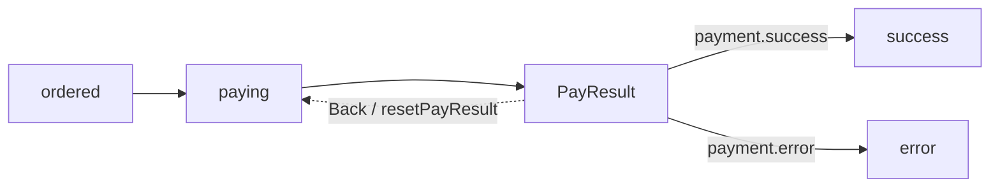

# DEC 设计模型

[返回文档总览](README.md)

读订单支付 Demo 时，可以把一份设计看成几张互相引用的表：有的表描述数据，有的表描述判断，有的表描述流程。它们合在一起，才回答“现在是什么情况”和“下一步能做什么”。本文先讲这种关系；逐字段限制仍以[规范索引](../../skills/dec-design/references/dec-yaml-spec.md)为准。

## 1. 八类 canonical YAML

每份文件都使用 `version: dec/v1`，由 `kind` 表示用途。Demo 的八类模型拆在十份 YAML 中，拆文件只是组织方式，不会改变它们之间的引用关系。

| kind | 主要结构 | 在订单 Demo 中解决的问题 | 详细规范 |
| --- | --- | --- | --- |
| `config` | DataSource、Connection、文件引用 | 外部能力是什么，设计怎样装配 | [config](../../skills/dec-design/references/yaml-spec/config.md) |
| `enum` | `enums` | 支付结果等公共枚举使用哪些稳定值 | [enum](../../skills/dec-design/references/yaml-spec/enum.md) |
| `data` | `datas` | 订单、明细和支付数据怎样落到表 | [data](../../skills/dec-design/references/yaml-spec/data.md) |
| `view` | `views` | 一次业务处理要看到哪些聚合数据 | [view](../../skills/dec-design/references/yaml-spec/view.md) |
| `rule` | `ruleViews` | 怎样检查、读取或更新这些数据 | [rule](../../skills/dec-design/references/yaml-spec/rule.md) |
| `api` | `apis` | HTTP 输入、校验和响应是什么 | [api](../../skills/dec-design/references/yaml-spec/api.md) |
| `systems` | `systems` | Information 属于哪个业务系统 | [system-information](../../skills/dec-design/references/yaml-spec/system-information.md) |
| `business` | `business.directories` | 提交订单和支付流程怎样推进 | [business](../../skills/dec-design/references/yaml-spec/business.md) |

引用是大小写敏感的精确引用。中文名称用于阅读，不能拿相似名称猜另一个节点；Java 类名或 SDK 类型也不应塞进业务设计。

## 2. Data、View、Enum 和 API

**Data 是存什么，View 是一次业务要看什么。** Data 描述字段、主键、表和数据源映射；View 把订单、明细、用户、支付信息组织成业务聚合。`OrderInfo` 之所以包含明细集合，是因为订单可以有多条明细，不能用一条明细代替整个集合。

View 不只是 HTTP 返回对象。Information、RuleView 和 Workflow 都依赖它的关系和可读写属性，所以关系写错会直接影响运行时判断。

Enum 使用显式整数值。比如支付结果在 HTTP JSON 中是整数，Java 枚举名称只是生成代码里的表达方式，不能擅自把接口值改成字符串。`relEnum` 把 Data 字段或 API 参数连接到公共枚举。

API 只描述传输契约：必填、长度、范围、正则和返回模型。订单是否可支付、用户是否有效这类业务条件，应该放在 RuleView、Information 或 Directory 中。Demo 的列表查询声明数组响应和 `modelRef`，因此生成器能生成 `List<OrderInfo>`。

## 3. RuleView 与 Rule

RuleView 可以理解为“围绕一个 View 的规则清单”。它有稳定 ID、名称、说明和按顺序执行的 Rule，也可以声明默认逻辑数据源。规则类型各自负责一件事：

| Rule 类型 | 适合做什么 |
| --- | --- |
| `check` | 检查一个属性，例如非空 |
| `checkPattern` | 用表达式检查多个属性 |
| `checkData` | 读取关联数据后检查 |
| `checkDataPattern` | 逐条读取并检查关联数据 |
| `get` / `query` | 读取单条或集合并回填模型 |
| `insert` / `update` / `delete` | 写入或删除外部数据 |
| `dsl` | 执行受支持的模型脚本 |

新设计使用 `dsl` 和命令字段 `cmd`。`grammer`、`sql` 是兼容输入，不表示任意旧规则或任意脚本都能运行；最终还要看编译器、驱动和应用适配器支持什么。可执行范围见[规则兼容性](../../dec-java-lite/docs/rule-compatibility.md)。

## 4. Information：描述当前事实

Information 用来回答“这个事实现在成立吗”，并归属于某个 System，例如 `order.payable`。它有三种互斥写法：

| 写法 | 含义 |
| --- | --- |
| `ruleRef` | 请某个 RuleView 来判断 |
| `ruleData` | 直接根据模型属性判断 |
| `expression` | 组合其他 Information，例如 `order.ordered or order.waitPay` |

识别结果不是简单的 true/false，还包括 `UNRESOLVED` 和 `ERROR`。数据没装配、求值器没注册时，不能把“暂时无法判断”当成“条件不成立”。

`changeData` 说明怎样把一个原子事实写入模型。Runtime 写入后会重新识别并记录变化；组合 Information 不应自己偷偷修改多个状态字段。这样，“如何判断订单状态”和“怎样进入订单状态”仍然能互相对应。

## 5. Directory：描述流程怎样推进

Directory 把事实和动作串成业务阶段。订单支付流程可以画成这样：



| 元素 | 在 Demo 中的作用 |
| --- | --- |
| Directory | 一个阶段及其操作，例如 `ordered`、`paying`、`PayResult` |
| `informationRef` | 进入或识别阶段所依据的事实 |
| Dependency | 执行动作前必须成立的事实，例如 `order.payable`、`user.effective` |
| Action | 按顺序执行的动作，例如 `startPay`、`receivePayResult` |
| Produce | 动作产生的模型或事实，例如支付信息 |
| Change | 要物化的目标 Information |
| case | 结果阶段的分支，例如 `payment.success → success` |
| Back | 明确的回退边和回退动作 |

`subDirectories` 不总是“从父节点走向子节点”的箭头；在本设计中，`paying` 引用 `ordered` 表示前置阶段。Back 也不是数据库技术上的 rollback，而是一次新的业务操作。完整定义见[业务 YAML](../../demo/order-payment-yaml/business-order-payment.yaml)，可视化见[流程 HTML](../../demo/design-html/directory/order-payment.html)。

## 6. 自定义 Action 与逻辑数据源

没有 `ruleRef` 的 Action 由应用按名称注册。例如：

```yaml
- id: ACT-SMS-NOTIFY
  name: smsNotify
```

运行时会查找 `CustomAction.name() == "smsNotify"` 的实现。设计只说明什么时候发送通知，应用负责把它接到短信平台。

规则操作的数据源按下面顺序寻找：

```text
Action.dataSource → Rule.dataSource → RuleView.dataSource → Business.dataSource
```

Demo 的 Business 默认是 `data1`，发起支付使用 `paymentService`，记录错误使用 `mongo1`。这些名称会出现在 YAML、XML、HTML 和 Flow 投影中；真正执行时，再由应用把逻辑名称映射到已注册的实现。声明数据源不会让校验器或 DSL 自动访问数据库。

## 7. Design ID：贯穿设计和实现的身份

名称方便业务人员阅读，ID 负责稳定追踪。改名时通常保留原 ID，这样代码生成、Binding、XML 的 `dec-id` 注释和 HTML 导航仍能指向同一个设计节点。

修改模型或流程后，按[验证手册](development-and-verification.md)更新派生产物和证据；如果修改的是外部 XML，先看[同步指南](xml-to-yaml-sync.md)，不要用全量反向转换覆盖现有 YAML。
