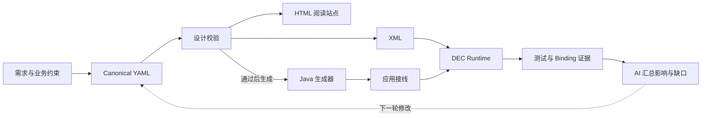
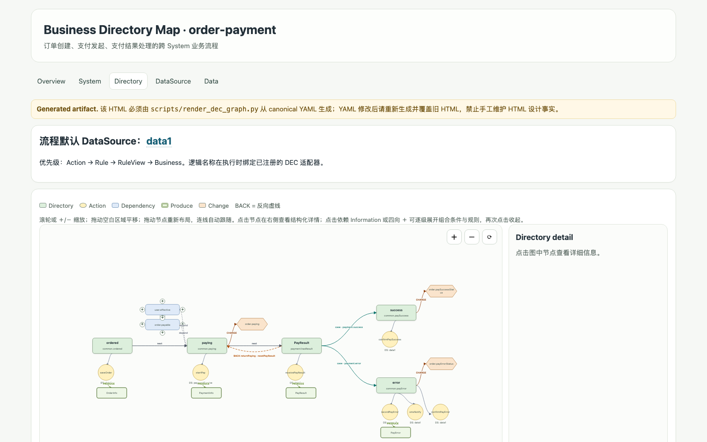
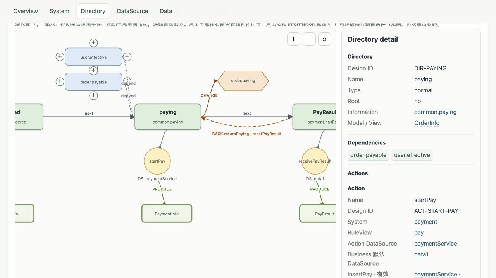
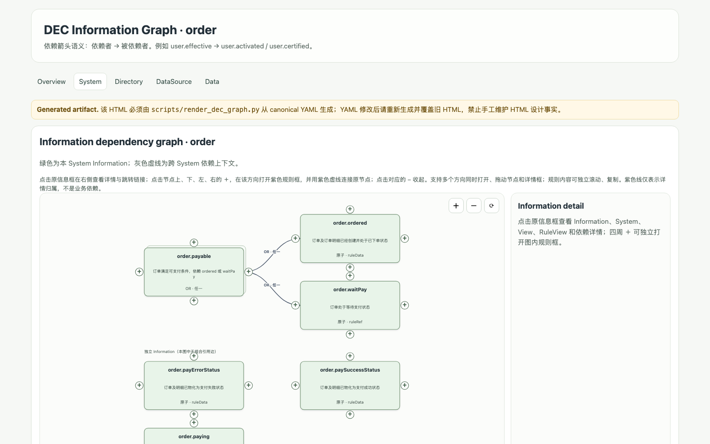

# 文档即编码(六)：与AI的结合

[返回文档总览](https://github.com/szlwin/doc-eq-code-Dgremlin-skills/blob/ec4d23ec80d024943d99e4658577c631f763cde7/docs/cn/README.md) · [项目理念](https://github.com/szlwin/doc-eq-code-Dgremlin-skills/blob/ec4d23ec80d024943d99e4658577c631f763cde7/docs/cn/philosophy.md) · [订单支付 Demo](https://github.com/szlwin/doc-eq-code-Dgremlin-skills/blob/ec4d23ec80d024943d99e4658577c631f763cde7/docs/cn/order-payment-demo.md)

本篇承接[《文档即编码(五)：设计银弹》](https://blog.csdn.net/szlwin/article/details/141533962)，继续探索一个问题：当设计文档能够精确表达业务并由引擎执行时，AI 可以怎样参与设计与实现？

原项目 [doc-eq-code-Dgremlin](https://github.com/szlwin/doc-eq-code-Dgremlin) 中的目录（Directory）和信息树（Information）还在开发中，因此先建立了 [doc-eq-code-Dgremlin-skills](https://github.com/szlwin/doc-eq-code-Dgremlin-skills) 这个小项目，用较小的范围验证与 AI 协作的方式。当前仓库通过两个 Skill、一个轻量 Java 框架和一个订单支付 Demo，把设计校验、产物生成、Runtime 执行和实现证据串在一起。本文介绍的是这个验证项目，不能据此认定原项目中的对应能力已经完成。

这里的 AI 主要参与开发：协助建模、编写设计、实现适配和验证结果。Demo 的订单请求由 Java Runtime 按设计执行，不需要在每次支付时调用大模型。

先把第五篇涉及的几个方向与当前验证范围对齐，后面的例子就更容易理解：

| 前文涉及的方向 | 当前项目做到哪里 | 阅读 Demo 时应怎样理解 |
| --- | --- | --- |
| 查询业务的历史经历 | 订单查询按 Information 识别当前事实，尚无完整的历史经历查询 | Back 后清除的支付结果不会继续命中当前“支付结果”查询 |
| 自动寻找执行路径 | 框架已有 `PathPlanner` 和 `DirectoryEngine.executeTo`；订单 HTTP 接口通过 `requireSingleStep` 限制为逐步推进 | 可以检查已声明流程图上的路径，但不能通过一次 HTTP 请求跳过支付、回调等步骤直达成功 |
| 退款、取消等流程 | 本 Demo 声明了提交、支付、成功/失败分支和 Back，未实现退款、取消流程 | Back 是重置结果并恢复支付中，不是退款或取消 |

路径能力与单步约束见 [Directory Runtime](https://github.com/szlwin/doc-eq-code-Dgremlin-skills/blob/ec4d23ec80d024943d99e4658577c631f763cde7/dec-java-lite/docs/directory-runtime.md)，当前业务范围见[订单支付示例](https://github.com/szlwin/doc-eq-code-Dgremlin-skills/blob/ec4d23ec80d024943d99e4658577c631f763cde7/docs/cn/order-payment-demo.md)。这个小项目要先验证的是：同一份设计能否让人审阅、让工具生成、让 Runtime 执行，并让 AI 找到对应的实现和验证依据。

## 一、为什么要把设计文档交给 AI

直接对 AI 说“根据需求写代码”，通常会遇到三个问题：需求中的概念没有稳定边界，同一条规则会在不同文件里被重复解释，生成结果也很难证明已经覆盖了真实场景。设计文档如果只是给人看的说明书，AI 仍然需要自行猜测上下文和工程约束。

DEC 的做法是把设计变成结构化、可校验、可执行的输入。AI 读取的不是一段孤立的自然语言，而是一组有稳定 Design ID 的 Data、View、RuleView、Information、Directory 和 API。验证器、生成器、Runtime 与 Binding 又为这些节点提供了可重复的反馈。这样，AI 的工作从“凭经验写一份代码”变成“在一条可检查的链路上推进一个变更”。



图中展示推荐的开发顺序：先通过设计校验，再把同一份 canonical YAML 交给 Java 生成器。Java CLI 会自行解析设计并检查设计缺口，但不会自动调用 Python 的 `validate_dec_yaml.py`；这项前置校验需要由开发者、AI 或 CI 显式执行。

这条链路给 AI 带来几项实际优势：

| 优势 | 在当前项目中的落点 | 对协作的意义 |
| --- | --- | --- |
| 语义有锚点 | 每个设计节点有稳定 Design ID，代码注释、HTML、索引和 Binding 都能回指它 | AI 可以定位“改哪一条规则”，不必依赖模糊的文件名或自然语言搜索 |
| 上下文可按需读取 | [根目录 README.zh-CN.md](https://github.com/szlwin/doc-eq-code-Dgremlin-skills/blob/ec4d23ec80d024943d99e4658577c631f763cde7/README.zh-CN.md)、设计规范、[demo/order-payment-app/DEC-DESIGN-INDEX.md](https://github.com/szlwin/doc-eq-code-Dgremlin-skills/blob/ec4d23ec80d024943d99e4658577c631f763cde7/demo/order-payment-app/DEC-DESIGN-INDEX.md) 和各层文档分别说明职责 | 不需要把整个仓库一次塞进上下文，AI 可以先读入口，再按影响范围展开 |
| 一份源，多种产物 | canonical YAML 派生 XML、HTML 和 Java 骨架 | AI 修改设计源后可以重生成产物，减少手工同步造成的漂移 |
| 反馈是可执行的 | `validate_dec_yaml.py`、`yaml_to_xml.py --check`、HTML 重生成、Maven 测试和 Binding 校验 | “看起来正确”可以被转换成具体的通过、失败或缺口 |
| 影响可以追踪 | Information 依赖图、Directory 边、生成索引和实现 Binding | AI 能从一个 Design ID 找到受影响的流程、代码和测试 |
| 人机分工更清楚 | 人确认业务语义、边界和外部系统契约，AI 负责检索、修改、生成和回归 | 有助于减少重复操作，让人把注意力放在业务决策和验收上 |

这些收益来自工具链提供的条件：稳定 ID 为定位提供依据，分层文档支持按影响范围读取，脚本让重复操作可以复现。本文没有做 AI 与人工开发的效率对照实验，因此不据此给出速度提升或缺陷减少的量化结论。后面会用已实现的短信通知说明这些条件具体怎样用。

这里的关键不是让 AI 直接接管项目，而是给 AI 一个可以持续读取的“外部工程记忆”：设计源说明业务是什么，Skill 说明怎样修改，工具说明怎样验证，Binding 说明哪些内容已经有实现证据。

## 二、Demo 里有哪些内容

本篇基于仓库 `ec4d23e` 的 Demo（2026-10-25 核对快照）：10 份 canonical YAML、118 个稳定 Design ID、6 个 API、19 个 Information，以及由脚本生成的 38 个 HTML 页面。根据仓库的[集成验证记录](https://github.com/szlwin/doc-eq-code-Dgremlin-skills/blob/ec4d23ec80d024943d99e4658577c631f763cde7/demo/INTEGRATION.md)，Binding 对 118 个节点全部覆盖并标记为 `VERIFIED`；支付平台、MongoDB 和短信仍使用本地替身。该记录说明既有 Demo 的验证状态，设计或实现改变后仍需重新生成测试证据。

118 个节点全部 `VERIFIED` 表示这些节点有相应的实现映射及验证证据，不等于所有业务场景、并发组合或生产故障都已覆盖。

三个组成部分的分工如下：

| 组成部分 | 输入与输出 | 怎样配合 AI |
| --- | --- | --- |
| [dec-design](https://github.com/szlwin/doc-eq-code-Dgremlin-skills/blob/ec4d23ec80d024943d99e4658577c631f763cde7/skills/dec-design/SKILL.md) | 从需求、业务约束或已有设计得到 canonical YAML，再校验并派生 XML/HTML | 用规范、模板和脚本约束 AI 的建模与修改；canonical 指唯一权威设计源 |
| [dec-implementation](https://github.com/szlwin/doc-eq-code-Dgremlin-skills/blob/ec4d23ec80d024943d99e4658577c631f763cde7/skills/dec-implementation/SKILL.md) | 消费已校验设计，完成应用接线、适配、测试与 Implementation Binding | 让 AI 按设计节点追踪实现和测试；Binding 是节点与代码、证据的对应清单 |
| [dec-java-lite](https://github.com/szlwin/doc-eq-code-Dgremlin-skills/blob/ec4d23ec80d024943d99e4658577c631f763cde7/dec-java-lite/README.md) | 解析设计、生成 Java 骨架、编译并运行规则与流程 | 用确定性程序完成转换和执行，AI 负责调用工具及处理明确的缺口 |

Skill 在这里包含工作约定、参考规范及配套脚本。它能把项目知识交给 AI，但约定是否被落实，仍需通过工具和测试检查。

从目录看，四类内容各有职责：

| 目录 | 作用 | AI 适合做的工作 |
| --- | --- | --- |
| [`demo/order-payment-yaml`](https://github.com/szlwin/doc-eq-code-Dgremlin-skills/tree/ec4d23ec80d024943d99e4658577c631f763cde7/demo/order-payment-yaml) | 唯一的设计源，声明 Data、View、Rule、Information、Directory、API 等 | 根据确认过的需求提出最小 YAML 变更，并检查引用和边界 |
| [`demo/order-payment-xml`](https://github.com/szlwin/doc-eq-code-Dgremlin-skills/tree/ec4d23ec80d024943d99e4658577c631f763cde7/demo/order-payment-xml) | YAML 派生出的 XML，供交换和运行时加载 | 运行转换器、比较漂移，不直接手改 |
| [`demo/design-html`](https://github.com/szlwin/doc-eq-code-Dgremlin-skills/tree/ec4d23ec80d024943d99e4658577c631f763cde7/demo/design-html) | 面向人的流程、信息树和设计详情站点 | 重生成页面、核对页面是否能解释设计 |
| [`demo/order-payment-app`](https://github.com/szlwin/doc-eq-code-Dgremlin-skills/tree/ec4d23ec80d024943d99e4658577c631f763cde7/demo/order-payment-app) | 生成骨架、手写适配、Runtime 接线和测试 | 按 Design ID 定位实现，补充适配器、测试和证据 |

应用启动时加载打包的 XML，编译 RuleView、Information 和 Directory；请求执行时由 Runtime 检查依赖、选择分支、调用 Action，并将结果写回应用的数据模型。生成的 `OrderInformation`、`PaymentInformation` 和 `OrderPaymentFlow` 是只读设计投影，方便代码和 AI 导航，不是另一套状态机。

## 三、跟着一笔订单走完 Demo

先看整张流程图，再沿着提交、支付和结果分支往下读。



*图 1：订单支付流程总览。由左向右看 ordered、paying、PayResult，再看 success/error 分支；橙色虚线表示 Back。节点细节见下方局部图，原 HTML 下载后可在本地缩放查看。*

订单支付流程可以按下面的顺序阅读：

1. **提交订单**：`saveOrder` 通过校验规则保存订单和明细，流程进入 `ordered`。
2. **发起支付**：Runtime 先检查订单可支付、用户有效等 Information，再执行 `startPay`，流程进入 `paying`。
3. **接收结果**：`receivePayResult` 保存支付结果，并按成功或失败条件进入两个分支。
4. **成功分支**：更新订单和支付状态，形成支付成功的当前事实。
5. **失败分支**：记录支付错误、安排通知并更新订单状态；需要重试时可通过 Back 动作重置支付结果，回到允许的业务阶段。
6. **阶段查询**：查询 API 使用同一套 View、Directory 和 Information 识别当前状态，不会执行 Action、Change 或 Back。

流程图中的每个节点都能继续追踪：Directory 节点对应流程阶段，Action 对应动作，Produce/Change 对应数据变化，Information 对应“当前事实”，RuleView 则组织具体检查、读取和写入规则。这样，AI 可以回答“支付失败后会做什么”，也可以进一步定位“这个动作由哪个 Java 类和哪条测试负责”。

### 信息树怎样帮助复用判断

例如订单信息图中，`order.payable` 由 `order.ordered` 或 `order.waitPay` 组合而成；用户信息中，`user.effective` 组合了激活和认证要求。支付入口引用这些已有事实。AI 修改条件时，可以沿依赖关系找到定义及使用位置，避免在 Controller、Service 和查询接口中分别写出几套近似判断。

“信息树”是一种便于理解的称呼，实际依赖可能形成共享节点的图。Information 回答当前事实是否成立，Directory 再把这些事实用于阶段识别、前置条件和分支选择。



*图 2：在实际生成页面中选中 paying 并放大。左侧可见 order.payable、user.effective 两项前置条件，右侧详情给出 DIR-PAYING、OrderInfo、startPay 和 paymentService。阅读时可以沿“条件 → 阶段 → 动作 → 数据源”核对，而不必从整张图中寻找小字。*

### 从 HTTP 请求观察成功、失败和回退

准备 JDK 21、Python 依赖以及专用 MySQL 演示库，按[应用运行说明](https://github.com/szlwin/doc-eq-code-Dgremlin-skills/blob/ec4d23ec80d024943d99e4658577c631f763cde7/demo/order-payment-app/README.md)设置 `DEC_DB_URL`、`DEC_DB_USERNAME`、`DEC_DB_PASSWORD`。从仓库根目录安装框架并启动应用：

```sh
./dec-java-lite/mvnw -f dec-java-lite/pom.xml install -DskipTests
./dec-java-lite/mvnw -f demo/order-payment-app/pom.xml spring-boot:run
```

第一条命令跳过测试，仅用于准备构建依赖。行为验证的完整命令见[开发与验证手册](https://github.com/szlwin/doc-eq-code-Dgremlin-skills/blob/ec4d23ec80d024943d99e4658577c631f763cde7/docs/cn/development-and-verification.md)；数据库测试会清理测试库中的 `dec_demo_*` 数据。

应用启动后，在另一个终端按顺序执行。下面的 `101` 是示例订单 ID，必须尚未被占用；若已存在，请将所有请求中的 `101` 一起换成新的 ID。[OrderWorkflow.submitOrder](https://github.com/szlwin/doc-eq-code-Dgremlin-skills/blob/ec4d23ec80d024943d99e4658577c631f763cde7/demo/order-payment-app/src/main/java/com/example/orderpayment/order/workflow/OrderWorkflow.java) 会拒绝重复提交已有订单，返回 HTTP 409（Conflict），不会覆盖原订单。

```sh
# 1. 提交订单，创建一条商品明细
curl -X POST http://localhost:8080/api/orders/101/submit \
  -H 'Content-Type: application/json' \
  -d '{"status":1,"type":1,"userId":1,"productId":7,"productName":"Demo item","productPrice":14.95,"productCount":2,"remark":"demo-order"}'

# 2. 发起支付
curl -X POST http://localhost:8080/api/orders/101/payment

# 3. 模拟失败结果：进入 error 分支
curl -X POST http://localhost:8080/api/orders/101/payment/result \
  -H 'Content-Type: application/json' -d '{"resultCode":2}'
curl http://localhost:8080/api/orders/101

# 4. 执行业务回退，再模拟成功结果
curl -X POST http://localhost:8080/api/orders/101/payment/back
curl -X POST http://localhost:8080/api/orders/101/payment/result \
  -H 'Content-Type: application/json' -d '{"resultCode":1}'
curl http://localhost:8080/api/orders/101
```

下面是依据现有设计及 [OrderWorkflowTest](https://github.com/szlwin/doc-eq-code-Dgremlin-skills/blob/ec4d23ec80d024943d99e4658577c631f763cde7/demo/order-payment-app/src/test/java/com/example/orderpayment/demo/OrderWorkflowTest.java) 中成功、失败和 Back 场景整理的预期值，不是本次实际运行输出。订单状态观察 `status`，明细观察 `orderDetailList[].status`，支付结果观察 `payInfo.resultCode`；这些数字分别对应各自的枚举。

| 操作完成后 | 订单及明细状态 | 支付结果 |
| --- | --- | --- |
| 提交订单 | `1`（待支付） | 尚无支付信息，`payInfo` 为空 |
| 发起支付 | `2`（支付中） | 支付信息已生成，`resultCode` 为空 |
| 收到失败结果 | `4`（支付失败） | `2`（失败） |
| Back 回退 | `2`（支付中） | `resultCode` 清空，支付信息仍保留 |
| 再收到成功结果 | `3`（支付成功） | `1`（成功） |

观察重点是订单、明细、支付信息是否一起变化，而不仅是 HTTP 是否返回成功。失败路径里的短信 Action 会登记提交后回调，数据库提交后才调用发送器；当前发送器只输出日志。Back 是一次新的业务操作，用于清除结果并恢复“支付中”的事实，不会撤销已经提交过的事务或已经发生的外部通知。

### 按业务阶段查询

Demo 还有一个值得关注的功能：查询可以复用流程设计中的业务概念。下面是[已有 Java 查询示例](https://github.com/szlwin/doc-eq-code-Dgremlin-skills/blob/ec4d23ec80d024943d99e4658577c631f763cde7/demo/order-payment-app/src/main/java/com/example/orderpayment/order/query/OrderQueryExamples.java)的调用形式，`orders` 是注入的 `OrderQueryService`：

```java
orders.find(BusinessQuery.find("订单").eq("支付结果"));
orders.find(BusinessQuery.find("订单").start("已订购").end("支付成功"));
orders.find(BusinessQuery.find("订单").with("用户")
    .start("已订购").end("支付成功"));
```

“支付结果”包含成功和失败两类；“已订购到支付成功”包含已订购、支付中、支付成功，排除失败分支；`with("用户")` 加载关联用户。中文名称通过显式别名映射到设计节点，而不是让大模型在运行时猜测 SQL。这让 AI 在编写查询代码时也能复用同一套业务词汇。

对应的 HTTP 查询例如：

```sh
curl --get http://localhost:8080/api/orders \
  --data-urlencode 'start=已订购' --data-urlencode 'end=支付成功' \
  --data-urlencode 'with=用户,明细'
```

Demo 已有一处支付错误记录：[LocalPaymentErrorAdapter](https://github.com/szlwin/doc-eq-code-Dgremlin-skills/blob/ec4d23ec80d024943d99e4658577c631f763cde7/demo/order-payment-app/src/main/java/com/example/orderpayment/payment/adapter/LocalPaymentErrorAdapter.java) 会向 `dec_demo_payment_error` 表写入订单 ID 和失败结果码，作为 MongoDB 错误记录的本地替身。这张表只记录失败，没有保存完整的阶段变更历史，也没有接入上述查询。

因此，要区分当前事实与历史记录。上述查询识别的是当前事实：回退并清除支付结果后，订单就不再因为曾经成功或失败而命中“支付结果”。完整历史审计还需要额外的事件或业务流水记录，属于后续演进范围。

## 四、生成 HTML 是给人和 AI 共同使用的阅读层

从仓库根目录可以重新校验并生成 Demo 的阅读站点：

```sh
python3 skills/dec-design/scripts/validate_dec_yaml.py demo/order-payment-yaml
python3 skills/dec-design/scripts/yaml_to_xml.py demo/order-payment-yaml --check
python3 skills/dec-design/scripts/render_dec_graph.py \
  demo/order-payment-yaml -o demo/design-html
```

其中 `yaml_to_xml.py --check` 只验证内存转换能否成功，不会写出 XML，也不会比较已有 XML 是否漂移。核对磁盘上的派生产物，应按[开发与验证手册 §7](https://github.com/szlwin/doc-eq-code-Dgremlin-skills/blob/ec4d23ec80d024943d99e4658577c631f763cde7/docs/cn/development-and-verification.md#7-%E6%A3%80%E6%9F%A5%E6%B4%BE%E7%94%9F%E4%BA%A7%E7%89%A9%E6%9C%89%E6%B2%A1%E6%9C%89%E6%BC%82%E7%A7%BB)在临时目录重新生成后比较。

入口页面是 [`demo/design-html/index.html`](https://github.com/szlwin/doc-eq-code-Dgremlin-skills/blob/ec4d23ec80d024943d99e4658577c631f763cde7/demo/design-html/index.html)。阅读时可以先看 [Directory 总览](https://github.com/szlwin/doc-eq-code-Dgremlin-skills/blob/ec4d23ec80d024943d99e4658577c631f763cde7/demo/design-html/directories.html)，再进入 [订单支付流程图](https://github.com/szlwin/doc-eq-code-Dgremlin-skills/blob/ec4d23ec80d024943d99e4658577c631f763cde7/demo/design-html/directory/order-payment.html)，最后查看 [订单 Information 依赖图](https://github.com/szlwin/doc-eq-code-Dgremlin-skills/blob/ec4d23ec80d024943d99e4658577c631f763cde7/demo/design-html/system/order/information.html)。页面里的黄色提示也说明了一个重要约定：HTML 是派生物，不能把它当成新的设计源手工维护。

这些 HTML 链接在 GitHub 上显示的是文件源码，不是已部署的交互站点。下载或克隆仓库后，用本地浏览器打开 `demo/design-html/index.html`，并保留整个目录结构，才能使用跨页跳转和图形交互。

前面的流程图把阶段、Action、Produce、分支和 Back 放在一起；下面的信息图进一步展示“订单已下单”“订单可支付”“订单待支付”等事实之间的依赖。



*图 3：`system/order/information.html` 页面上部截取。箭头从依赖者指向被依赖者；节点周围的加号可以展开规则详情。*

这两个页面对 AI 也有价值。模型可以先从 HTML 快速建立全局地图，再回到 YAML 和 Design ID 读取精确语义；人则可以用图形检查“流程是否完整”“信息依赖方向是否合理”，不必先阅读所有 XML 或 Java 文件。

## 五、用已实现的短信通知看 AI 怎样参与

“支付失败后发送通知”适合把前面的概念串起来：它既有设计入口，也有外部副作用和事务边界。以下沿现有文件说明 AI 可以怎样定位、分析和验证，不是一次虚构的 AI 开发过程记录。

### 先从业务节点找到实现

通过正式 `yaml_io.py` 读取[业务设计](https://github.com/szlwin/doc-eq-code-Dgremlin-skills/blob/ec4d23ec80d024943d99e4658577c631f763cde7/demo/order-payment-yaml/business-order-payment.yaml)，可以找到 `error` 目录下的这个 Action。下面只摘录该节点，不能作为独立设计文件使用：

```yaml
- id: ACT-SMS-NOTIFY
  name: smsNotify
```

它排在 `recordPayError` 之后、`confirmPayError` 之前，没有 `ruleRef`。Runtime 因此按自定义 Action 名称寻找实现。生成的 [CustomActionConfiguration](https://github.com/szlwin/doc-eq-code-Dgremlin-skills/blob/ec4d23ec80d024943d99e4658577c631f763cde7/demo/order-payment-app/src/main/java/com/example/orderpayment/config/CustomActionConfiguration.java) 收集 Spring 的 `CustomAction` Bean，并交给注册表：

```java
return CustomActionRegistry.from(actions.orderedStream().toList());
```

应用中的 [SmsNotifyAction](https://github.com/szlwin/doc-eq-code-Dgremlin-skills/blob/ec4d23ec80d024943d99e4658577c631f763cde7/demo/order-payment-app/src/main/java/com/example/orderpayment/payment/action/SmsNotifyAction.java) 实现 `CustomAction`，其 `name()` 返回 `"smsNotify"`，与设计名称对齐。它检查订单 ID 和活动事务后，登记以下回调：

```java
TransactionSynchronizationManager.registerSynchronization(new TransactionSynchronization() {
    @Override public void afterCommit() { sender.sendPaymentError(orderId); }
});
```

因此，这条链可以具体写成：

```text
ACT-SMS-NOTIFY / smsNotify
  → CustomActionConfiguration 收集并注册实现
  → Runtime 调用 SmsNotifyAction.execute
  → 登记 afterCommit
  → 数据库提交后调用 SmsSender.sendPaymentError
```

AI 沿着 ID、名称和注册关系，就有依据把“发送短信”定位到实际扩展点，也能发现“Action 执行成功”只代表回调已登记。当前 `LoggingSmsSender` 只写日志；平台送达、持久重试还需要其他实现。

### 再用测试和 Binding 判断完成了什么

[Implementation Binding](https://github.com/szlwin/doc-eq-code-Dgremlin-skills/blob/ec4d23ec80d024943d99e4658577c631f763cde7/demo/order-payment-implementation-binding.yaml) 中 `designId: ACT-SMS-NOTIFY` 的条目把设计节点绑定到 `SmsNotifyAction#execute`、`SmsSender#sendPaymentError`、注册配置和监听器，并列出相应测试。[OrderWorkflowTest](https://github.com/szlwin/doc-eq-code-Dgremlin-skills/blob/ec4d23ec80d024943d99e4658577c631f763cde7/demo/order-payment-app/src/test/java/com/example/orderpayment/demo/OrderWorkflowTest.java) 中有以下具体检查：

| 测试方法 | 检查的行为 |
| --- | --- |
| `customSmsActionSendsOnlyAfterTheOuterTransactionCommits` | 外层事务提交前不调用发送器，提交后调用一次 |
| `customSmsActionDoesNotSendWhenTheOuterTransactionRollsBack` | 外层事务回滚时不发送通知 |
| `afterCommitSmsFailureLeavesCommittedStateAndRetryDoesNotResend` | 发送器抛异常不会撤销已提交状态，重复业务回调也不会自动补发 |

例如提交时序测试的核心断言是：

```java
new TransactionTemplate(transactionManager).executeWithoutResult(status -> {
    workflow.receivePaymentResult(105L, PayResultCode.ERROR);
    verifyNoInteractions(smsSender);
});
verify(smsSender).sendPaymentError(105L);
```

这是对当前测试源码的摘录，本次文章调整没有重跑 MySQL 集成测试。它能验证发送器调用时序，不能证明短信平台实际送达。

假设下一步要接入真实短信平台，AI 可以先从这份 Binding 找到 `SmsSender` 扩展点，再核对实现 Bean、事务时序测试和证据是否需要更新。若需求同时增加“失败后可靠重试”，现有 `afterCommit` 就不够了，还要设计持久记录、重试与幂等契约。稳定 ID 和证据清单为这种影响分析提供了范围，而测试给出了可检查的行为；它们有助于减少漏改，却不能代替场景设计和实际运行验证。

## 六、一次适合交给 AI 的变更流程

假设要增加“订单超过支付期限后不能发起支付”。这是后续变更示例，当前 Demo 没有实现支付期限校验。一次 AI 协作过程可以这样展开：

1. 先确认超时的起算字段、时区、边界时刻和超时后的允许动作；这些是业务决策，不能由 AI 自行补全。
2. 让 AI 阅读 `skills/dec-design/SKILL.md` 和 `skills/dec-implementation/SKILL.md`，通过各自的正式 I/O 脚本读取设计与 Binding，结合订单流程 HTML 和现有测试输出影响分析。
3. 在 `systems` 中新增“是否在支付期限内”的 Information，在 `rule-order.yaml` 中声明对应 RuleView，并把它加入支付入口的依赖。
4. 运行设计校验，重新生成导出 XML、应用 `src/main/resources/dec/design` 中的 XML 和 HTML，检查差异是否只包含预期节点。
5. 按[开发与验证手册 §3](https://github.com/szlwin/doc-eq-code-Dgremlin-skills/blob/ec4d23ec80d024943d99e4658577c631f763cde7/docs/cn/development-and-verification.md#3-%E6%9E%84%E5%BB%BA%E6%A1%86%E6%9E%B6%E5%B9%B6%E7%94%9F%E6%88%90%E5%BA%94%E7%94%A8%E9%AA%A8%E6%9E%B6)的完整命令定位 CLI JAR，执行 `generate` 重新生成 Java 骨架和设计投影。随后按新的 Design ID 补充 Binding 和行为测试。生成器只维护 manifest 管理的文件，手写实现仍需按接口变化调整。
6. 重建应用，执行 Runtime、应用和 Binding 验证，生成与当前输入匹配的验证证据；如果外部依赖仍是替身，要在结果中保留这个限制。

可以把下面的约束作为一次任务的起始提示，减少 AI 误改产物的机会：

```text
请基于当前仓库实现“支付期限校验”。
先阅读 docs/cn/README.md、skills/dec-design/SKILL.md、
skills/dec-implementation/SKILL.md，再按各 Skill 的 yaml_io.py
读取 demo/order-payment-yaml 中相关设计及实现 Binding，
结合 demo/design-html/directory/order-payment.html 和现有测试分析。

要求：
1. 先输出影响范围和需要确认的业务问题；
2. 只修改 canonical YAML、必要的实现、Binding 和测试；
3. 不手工修改 generated XML/HTML/Java；
4. 修改后先运行设计校验，再同步生成 demo/order-payment-xml 和
   demo/order-payment-app/src/main/resources/dec/design 中的 XML，并重生成 HTML；
5. 按需重新生成 manifest 管理的 Java 文件，调整手写接线并重建应用，
   确保 Runtime 加载本次设计；不要只更新页面；
6. 运行相关测试，按开发与验证手册生成与当前设计、Binding、源码和测试报告
   匹配的 Binding 验证证据，再执行证据校验；
7. 最后按 Design ID 列出变更、验证结果和仍未接通的外部能力。
```

这个提示的作用不是把规则写死在提示词里，而是让 AI 先遵循仓库已经存在的事实来源和验证入口。真正的约束仍由 YAML 规范、脚本、测试和 Binding 承担。

## 七、AI 结合后的边界

这套工具链有助于 AI 减少重复检索和转换，为影响分析及回归验证提供依据，但有几类判断不能用“生成成功”代替：

- 业务人员是否认可 Information 的含义、流程边界和失败策略；
- 并发、幂等、补偿、历史审计和权限要求，需要逐项核对设计的表达能力，再补齐相应的实现与验证；
- 支付平台、MongoDB、短信等外部能力是否真的接入，以及它们的超时、重试和一致性契约；
- 测试要覆盖有意义的成功、失败、重复、乱序和回滚场景，不能只验证正常路径。

当前 Demo 已验证 YAML → XML/HTML → Java 生成 → Runtime 执行 → 测试/Binding 证据的闭环，但不声称已经完成生产级的外部系统集成，也不把当前目录和信息树当成最终形态。采用这种方式的价值，在于每次扩展都能沿着同一条链路留下可阅读、可执行、可回归的事实。

## 八、结语

“文档即编码”与 AI 结合后，文档成为 AI、生成器、Runtime、测试和人共同使用的工程接口。AI 协助把确认后的意图落实到设计、产物和验证动作上；结构化设计和证据链为它提供可核对的依据；人负责做业务选择、接受风险并判断结果是否真的满足需求。

当前这个小 Demo 的意义，不在于展示一个已经完成的通用平台，而在于验证一个可继续演进的工作方式：先把业务事实和流程写成可执行设计，再让 AI 在可追踪、可验证的边界内参与实现。随着 Directory、Information 和更多数据源能力继续完善，这条链路可以逐步覆盖更复杂的系统，而不必重新回到“文档、代码、测试各说一套”的状态。
