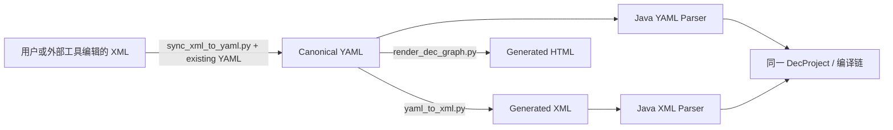

# YAML、XML 与 HTML：同一份设计的三种看法

[返回文档总览](README.md)

订单支付 Demo 里会同时看到 YAML、XML 和 HTML。它们不是三份各自维护的设计，而是同一份设计在不同场景下的三种看法：YAML 适合修改，XML 适合交换和运行时加载，HTML 适合人阅读。

## 1. 谁是依据，谁是产物

| 产物 | 主要使用者 | 怎样产生或更新 |
| --- | --- | --- |
| canonical YAML | 设计者、Skill、校验器、Java Parser | 正式 YAML I/O，或受控 XML 同步 |
| generated XML | 外部 DEC 工具、Java XML Parser、打包应用 | 由 YAML 转换生成 |
| generated HTML | 业务人员、开发者、Reviewer | 由 YAML 渲染生成 |

Java 的 YAML/XML 前端最后都会进入同一个 `DecProject` 和编译链。XML 能被执行，不等于它变成了另一份权威源；HTML 也不参与 Runtime，不能直接回写 YAML。



## 2. 在 Demo 里分别去哪找

| 路径 | 你会看到什么 |
| --- | --- |
| [demo/order-payment-yaml](../../demo/order-payment-yaml) | 订单支付的 canonical 设计源 |
| [demo/order-payment-xml](../../demo/order-payment-xml) | 对外导出的 XML |
| [应用 dec/design](../../demo/order-payment-app/src/main/resources/dec/design) | 随应用打包的 XML 镜像 |
| [dec/design-files.txt](../../demo/order-payment-app/src/main/resources/dec/design-files.txt) | Java 生成器维护的资源清单 |
| [demo/design-html](../../demo/design-html/index.html) | 多流程共享的阅读站点 |
| [DEC-DESIGN-INDEX.md](../../demo/order-payment-app/DEC-DESIGN-INDEX.md) | 设计节点与代码位置的索引 |

只更新 `demo/order-payment-xml` 而忘记更新应用里的 XML，应用仍会执行旧设计。资源清单只说明加载哪些文件，不负责生成 XML 内容。

## 3. 从 YAML 生成 XML 和 HTML

命令从仓库根目录执行：

```sh
python3 skills/dec-design/scripts/validate_dec_yaml.py demo/order-payment-yaml
python3 skills/dec-design/scripts/yaml_to_xml.py demo/order-payment-yaml --check

python3 skills/dec-design/scripts/yaml_to_xml.py demo/order-payment-yaml \
  -o demo/order-payment-xml --emit-id-comments
python3 skills/dec-design/scripts/yaml_to_xml.py demo/order-payment-yaml \
  -o demo/order-payment-app/src/main/resources/dec/design --emit-id-comments

python3 skills/dec-design/scripts/render_dec_graph.py demo/order-payment-yaml \
  -o demo/design-html
```

`yaml_to_xml.py --check` 只检查转换器是否能处理这份设计，不是导出目录与 YAML 的逐文件漂移比较。需要检查实际产物时，应在临时目录重生成，再按[验证手册](development-and-verification.md)比较。

`--emit-id-comments` 会写入 `<!-- dec-id: ... -->`，帮助运行时前端和外部编辑后的 rename 保持身份对应；它不会把 ID 擅自变成 XML 属性。

## 4. 怎样阅读 HTML

可以从[站点首页](../../demo/design-html/index.html)进入 System，再逐层查看 View、RuleView、API、Enum 和 Information。第一次阅读订单支付时，建议先看 `system/order/information.html`，再看 `directory/order-payment.html`。

| 页面 | 用途 |
| --- | --- |
| `index.html` | 设计总览 |
| `systems.html`、`system/<system>/index.html` | System 导航 |
| `system/<system>/information.html` | 信息依赖图 |
| `directories.html` | 所有 Business 的流程入口 |
| `directory/<business>.html` | 单个流程的详细图 |
| `datasources.html` | 逻辑数据源和连接索引 |

Information 图的箭头表示“当前节点依赖什么”。节点旁的 `+` 可以展开规则详情，`−` 收起；Directory 图则把阶段、Action、Dependency、Produce、Change 和 Back 放在同一张图里。缩放、平移、拖动只改变阅读方式，不改变设计。

展示有问题时，应修改渲染器并重新生成整站，不要手工修一张 HTML。更细的展示约定见[HTML 生成规范](../../skills/dec-design/references/design-html-generation.md)。

## 5. 多个流程怎样放进一个站点

`design-html/` 是共享目录，公共页面不带某个流程的前缀，每个 Business 放在 `directory/<business>.html`。如果有多个流程，应一次把相关 canonical 输入都交给渲染器：

```sh
# design/flow-a、design/flow-b 只是示意路径。
python3 skills/dec-design/scripts/render_dec_graph.py design/flow-a design/flow-b \
  -o generated/design-html
```

不要先渲染 flow-a，再单独渲染 flow-b 到同一个站点；后一次会覆盖共享索引。多个输入应在交给渲染器前确认 Design ID 不重复；渲染器会在写入前报告归一化文件名冲突，但不会替你检查跨输入的重复 Design ID。

HTML 可以汇总多个 Business，但一次 Workflow 或 BusinessQuery 编译仍要明确使用哪一块流程图。

## 6. XML 初次导入和后续同步不是一回事

还没有 canonical YAML 时，先做初次导入：

```sh
python3 skills/dec-design/scripts/xml_to_yaml.py external/design-xml -o imported/design-yaml
python3 skills/dec-design/scripts/validate_dec_yaml.py imported/design-yaml
```

已经有 YAML 时，外部 XML 的修改要用 `sync_xml_to_yaml.py --existing` 做语义合并。不要用全量反向导入覆盖已有文件，否则可能丢掉 YAML 独有元数据。具体风险见[XML 同步决策指南](xml-to-yaml-sync.md)，操作步骤以[Skill 同步规范](../../skills/dec-design/references/xml-yaml-sync.md)为准。
