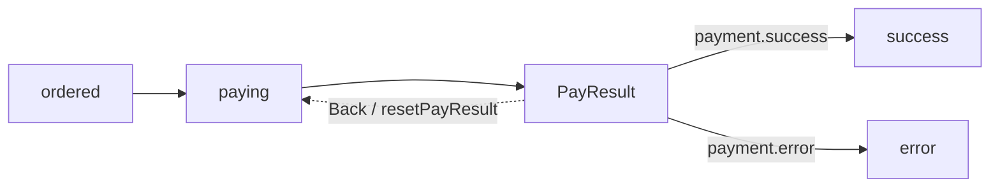

# DEC 设计模型

[返回文档总览](README.md)

本文解释各概念如何组合；完整字段约束见 [规范索引](../skills/dec-design/references/dec-yaml-spec.md)。示例片段用于解释，不是可单独加载的完整设计文件。

## 1. 八类 canonical YAML

每份 canonical 文档使用 `version: dec/v1`，通过 `kind` 决定语义。一个 kind 可以分成多份文件，因此 Demo 的八类模型由十份 YAML 承载。

| kind | 主要结构 | 解决的问题 | 详细规范 |
| --- | --- | --- | --- |
| `config` | DataSource、Connection、文件引用 | 外部能力是什么，设计如何装配 | [config](../skills/dec-design/references/yaml-spec/config.md) |
| `enum` | `enums` | 公共枚举名称、稳定值 | [enum](../skills/dec-design/references/yaml-spec/enum.md) |
| `data` | `datas` | 持久化数据、字段、表和数据源映射 | [data](../skills/dec-design/references/yaml-spec/data.md) |
| `view` | `views` | 面向业务的聚合模型及关联 | [view](../skills/dec-design/references/yaml-spec/view.md) |
| `rule` | `ruleViews` | 规则组合、数据操作、识别和脚本 | [rule](../skills/dec-design/references/yaml-spec/rule.md) |
| `api` | `apis` | URL、HTTP method、输入约束、响应 | [api](../skills/dec-design/references/yaml-spec/api.md) |
| `systems` | `systems` | 模型归属、Information、访问边界 | [system-information](../skills/dec-design/references/yaml-spec/system-information.md) |
| `business` | `business.directories` | 跨系统流程、动作、分类、回退 | [business](../skills/dec-design/references/yaml-spec/business.md) |

引用是大小写敏感的精确引用。不要依靠中文描述模糊匹配另一个节点，也不要把 Java 类名、SDK 类型等实现细节塞进业务设计。

## 2. Data、View、Enum 和 API

**Data** 描述数据本身及外部映射，例如订单实体的字段、主键和表。**View** 描述业务操作看到的聚合，可以组合订单、订单明细、用户与支付信息；一对一、一对多关系必须通过声明的关联字段连接。

View 不只是 HTTP 响应对象。Information、RuleView 和 Workflow 也基于 View 工作，因此其关系和可读写属性影响运行时行为。Demo 的 `OrderInfo` 由订单主记录及相关投影装配，不能用“一条明细代表所有明细”替代集合语义。

Enum 使用显式整数值，Data 字段和 API 参数可通过 `relEnum` 引用。Enum 的业务值与 Java 枚举名称不同：例如 HTTP JSON 中支付结果使用整数，不应擅自改成 Java 名称字符串。

API 只描述传输契约和字段校验，如必填、长度、范围、正则和返回模型。订单是否可支付、用户是否有效等业务条件应放入 RuleView/Information/Directory。当前列表查询声明数组响应和 `modelRef`，生成器据此生成 `List<OrderInfo>`。

## 3. RuleView 与 Rule

RuleView 是绑定到 View 的规则集合，包含稳定 ID、name、code、说明和有序 Rule。RuleView 可提供默认逻辑 DataSource，Rule 可以单独声明。

| Rule 类型 | 职责 |
| --- | --- |
| `check` | 单属性校验，例如 `NOTNULL` |
| `checkPattern` | 多属性表达式校验 |
| `checkData` | 读取关联数据后校验 |
| `checkDataPattern` | 读取数据后逐条表达式校验 |
| `get` / `query` | 单条/集合读取和模型回填 |
| `insert` / `update` / `delete` | 外部数据操作 |
| `dsl` | 执行受支持的模型脚本 |

新设计使用 `dsl` 和命令字段 `cmd`；`grammer`、`sql` 属于兼容输入，不能由此推断任意旧 DEC 规则或任意脚本都受支持。是否能执行还取决于编译器、驱动能力及已注册的适配器。详见 [规则兼容性](../dec-java-lite/docs/rule-compatibility.md)。

## 4. Information：识别事实和物化事实

Information 归属 System，以 `system.name` 引用，例如 `order.payable`。三种识别形式互斥：

| 形式 | 内容 | 作用 |
| --- | --- | --- |
| `ruleRef` | 引用 RuleView | 用规则识别事实 |
| `ruleData` | 模型表达式 | 直接读取模型属性识别事实 |
| `expression` | InformationKey 的逻辑组合 | 形成跨节点、可跨 System 的事实组合 |

`expression` 组合 Information，如 `order.ordered or order.waitPay`；它不是直接写 Java 条件的地方。模型表达式支持的集合判断可用于要求所有明细都符合条件。

识别结果区分 `TRUE`、`FALSE`、`UNRESOLVED` 和 `ERROR`。未装配的数据或未注册的求值器不能简单视为业务条件不成立。

`changeData` 描述如何写入事实，仅支持符合契约的 `ruleData` 原子 Information。Runtime 物化时执行访问检查、记录变更并重新识别；组合 Information 不应自行写入多个状态字段。设计中的“如何判定状态”和“如何进入状态”由此建立明确关联。

## 5. Directory：用 Information 编排流程

| 元素 | 作用 | Demo 例子 |
| --- | --- | --- |
| Directory | 某个业务阶段及其操作 | `ordered`、`paying`、`PayResult` |
| `informationRef` | 阶段的事实定义 | `common.paying` |
| Dependency | 执行动作前必须成立的事实 | `order.payable`、`user.effective` |
| Action | 有序业务动作 | `startPay`、`receivePayResult` |
| Produce | 动作产出及可选 Information 约束 | 支付信息、支付结果 |
| Change | 物化指定 Information | `order.paying` |
| case | 结果阶段的分类边 | `payment.success → success` |
| Back | 明确的业务回退边及回退动作 | 重置支付结果后返回 paying |

普通 `subDirectories` 关系在本设计中描述前置阶段：`paying` 中引用 `ordered`，执行方向为 `ordered → paying`。`role: case` 则是结果目录指向分类目标。不能把所有 `subDirectories` 都画成同方向执行边。

示例流程：



图中省略了依赖、Produce 和 Change；完整定义见 [业务 YAML](../demo/order-payment-yaml/business-order-payment.yaml)，可视化见 [流程 HTML](../demo/design-html/directory/order-payment.html)。Back 是新的一次业务执行，不是撤销已提交事务的技术 rollback。

## 6. 自定义 Action 与逻辑数据源

有 `ruleRef` 的 Action 调用规则；无 `ruleRef` 的自定义 Action 由应用按名称注册。例如：

```yaml
# business.directories 中 error.actions 的片段
- id: ACT-SMS-NOTIFY
  name: smsNotify
```

运行时据此查找 `CustomAction.name() == "smsNotify"` 的实现。设计说明“何时发送通知”，应用实现如何调用短信平台。

外部 Rule 操作的逻辑数据源优先级为：

```text
Action.dataSource → Rule.dataSource → RuleView.dataSource → Business.dataSource
```

Demo 的 Business 默认 `data1`，发起支付 Action 使用 `paymentService`，记录错误 Action 使用 `mongo1`。这些逻辑名称保留在 YAML、XML、HTML 和 Flow 投影中。执行时再选择某逻辑名称的已注册实现；本地校验与 DSL 不因声明数据源而额外执行数据库调用。

## 7. Design ID 是贯穿设计与实现的身份

名称用于业务引用，ID 用于稳定身份与追踪。重命名不应随意更换既有 ID。代码生成、Binding、XML 的可选 `dec-id` 注释和 HTML 导航依赖这一身份关系。

修改模型或流程后，按 [验证手册](development-and-verification.md) 更新派生产物与证据；外部 XML 的修改按 [同步指南](xml-to-yaml-sync.md) 合并，不能直接覆盖现有 YAML 的全部内容。
