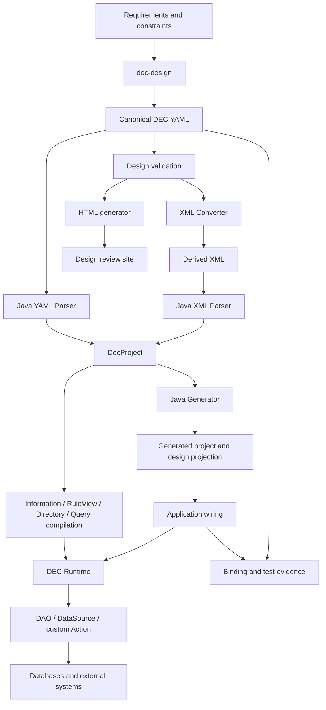

# Overall architecture

[Back to documentation home](README.md)

If you view the order-payment demo as a chain that runs from design to request, the directories in the repository become easier to understand: `dec-design` spells the business out, `dec-java-lite` reads and executes that design, the demo connects databases and external services, and `dec-implementation` records "which designs are already implemented by which code and tests".

## 1. From one rule to one request

Take the "payment result callback" as an example. The business design is first kept in canonical YAML, then tools generate XML and HTML from it; the Java framework reads the same design, and the application wires it to real resources.

Skills are the tools and working conventions used during development; the Java framework is the capability used while the application runs. Once the application has started, it does not re-invoke Skills on every request, nor does it have a model improvise a set of business code.

## 2. Four collaborating layers

| Layer | Where it lives in the repository | The main question it answers |
| --- | --- | --- |
| Design layer | `dec-design`, canonical YAML, spec and validators | What exactly are the business data, facts, flows, and APIs? |
| Framework layer | `dec-java-lite` | How is the design parsed, how are rules compiled, and how are flows executed? |
| Application layer | Generated skeleton and handwritten bindings | How are databases, transactions, and third-party services connected? |
| Evidence layer | `dec-implementation`, Binding, test reports | Which nodes are implemented, and does the evidence match the current version? |

HTML, the design index, and the generated Information/Flow classes are navigation between these layers. They help people read and locate things; they must not be treated as another business definition that can be modified independently.

## 3. Java module map

All modules live under [dec-java-lite](../../dec-java-lite). Find a module by the purposes below first; the exact Maven dependencies remain governed by each module's POM.

| Module | Main responsibility |
| --- | --- |
| `dec-lite-core` | Canonical AST, models, IDs, semantic summaries, and common error types |
| `dec-lite-parser` | YAML/XML front end, input safety, and classpath resource-manifest loading |
| `dec-lite-information` | Information compilation, dependency graph, recognition, and materialization |
| `dec-lite-action` | RuleView, DSL, custom Action, listeners, and external-action dispatch |
| `dec-lite-session` | Execution sessions, model workspaces, transaction resources, and scopes |
| `dec-lite-directory` | Flow compilation, advance/case/Back, WorkflowRunner, and transaction modes |
| `dec-lite-query` | Stage queries, SQL conversion, JDBC execution, View assembly, and filtering |
| `dec-lite-spring` | Bridging Spring-managed transactions and Runtime transactions |
| `dec-lite-generator` | Generation model, interfaces, configuration, design index, and artifact manifest |
| `dec-lite-cli` | Commands such as `inspect`, `generate`, `information`, `action`, `directory`, `query` |

## 4. Compile at startup, isolate per request

At startup, the demo reads the packaged XML through `new DecXmlParser().parseClasspath(classLoader, "dec/design-files.txt")` and builds a reusable `DirectoryWorkflowRunner`; the query service separately builds a `BusinessQueryRuntime`. The goal is practical: the design is compiled only once, and requests do not re-parse files over and over.

Each request still creates its own models, adapters, RuleView registry, Information evaluation environment, payload, and transaction scope. What is shared is the immutable design and the compiled results; one request's models or caches must not leak into another request.

The framework provides candidate-version validation and snapshot replacement for `RuntimeCatalog`, but the current demo does not automatically watch for file changes. After changing the design, regenerate, repackage, and rebuild the Runner; do not turn "the framework has a hot-swap interface" into "the demo has hot reload enabled".

## 5. How a payment result callback runs to completion

A `receivePaymentResult` request goes through roughly these steps:

1. The generated Controller validates the request parameters and calls the Service.
2. The handwritten ServiceImpl hands the request to `OrderWorkflow`, and Spring opens the application transaction.
3. Store/DAO reads and locks the order, and the Assembler converts the data into Runtime models.
4. The Runtime identifies the current Directory and checks dependencies, data sources, and listeners.
5. It executes the receive-result Action, enters the matching branch based on the success or failure condition, and executes the Change.
6. The completion callback saves the final model, reads it back from the DAO, and checks the result against the canonical Information.
7. The transaction owner commits; the registered post-commit actions then run.

Step 6 must happen before the physical commit. `after(Action)` means the action succeeded but is still before the commit; only `afterCommit` means the database has been committed.

## 6. The difference between queries and commands

`find("订单").start("已订购").end("支付成功")` first maps the Chinese aliases to the View and Directory in the design, then compiles the query plan from the flowchart. SQL handles the filtering and relation reads that can be safely pushed down; the remaining Information conditions are recognized by the Runtime.

The query first pins down the non-duplicated root records, then reads the complete relations and assembles the View, so that one-to-many JOINs do not distort pagination. If the candidate limit is reached and the requested page still cannot be completed, the query fails explicitly instead of returning a page that looks complete but is actually missing data.

Commands and queries can share the same set of business facts, but queries do not execute Action, Change, or Back. For concrete usage, see the [Java framework](java-framework.md) and the [order-payment example](order-payment-demo.md#7-query-orders-by-business-stage).

## 7. Data sources and transaction boundaries

A DataSource in the design is a logical capability such as "payment platform", "database", or "message service"; Java's `javax.sql.DataSource` is merely a JDBC connection resource — the two are not the same thing.

A flow can declare a default logical data source, and an Action can override it; the application then maps these logical names onto the actual adapters. This mapping does not automatically replace every DAO's connection, nor does it mean that several external systems can form one XA transaction. The current framework makes no XA promise, and reliable SMS delivery also needs separate mechanisms such as an Outbox and retries.
