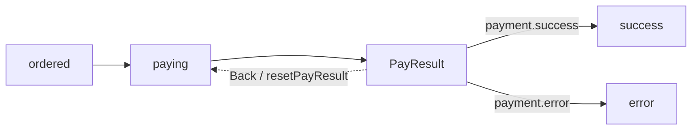

# DEC Design Model

[Back to documentation home](README.md)

When reading the order payment Demo, you can think of a design as several tables that reference each other: some tables describe data, some describe decisions, and some describe processes. Together, they answer "what is the current situation" and "what can be done next". This article explains these relationships first; for field-by-field constraints, the [specification index](../../skills/dec-design/references/dec-yaml-spec.md) remains authoritative.

## 1. The eight kinds of canonical YAML

Every file uses `version: dec/v1`, with `kind` indicating its purpose. The Demo's eight kinds of models are split across ten YAML files; splitting the files is only a way of organizing them and does not change the references between them.

| kind | Main structure | Problem it solves in the order Demo | Detailed specification |
| --- | --- | --- | --- |
| `config` | DataSource, Connection, file references | What the external capabilities are and how the design assembles them | [config](../../skills/dec-design/references/yaml-spec/config.md) |
| `enum` | `enums` | Which stable values shared enums such as the payment result use | [enum](../../skills/dec-design/references/yaml-spec/enum.md) |
| `data` | `datas` | How order, line-item, and payment data land in tables | [data](../../skills/dec-design/references/yaml-spec/data.md) |
| `view` | `views` | Which aggregated data a single business transaction needs to see | [view](../../skills/dec-design/references/yaml-spec/view.md) |
| `rule` | `ruleViews` | How to check, read, or update this data | [rule](../../skills/dec-design/references/yaml-spec/rule.md) |
| `api` | `apis` | What the HTTP inputs, validation, and responses are | [api](../../skills/dec-design/references/yaml-spec/api.md) |
| `systems` | `systems` | Which business system an Information belongs to | [system-information](../../skills/dec-design/references/yaml-spec/system-information.md) |
| `business` | `business.directories` | How order submission and the payment process advance | [business](../../skills/dec-design/references/yaml-spec/business.md) |

References are case-sensitive exact references. Chinese names are for reading; you must not guess another node from a similar name, and Java class names or SDK types should not be stuffed into the business design either.

## 2. Data, View, Enum, and API

**Data is what gets stored; View is what a single business transaction needs to see.** Data describes fields, primary keys, tables, and data source mappings; View organizes orders, line items, users, and payment information into a business aggregate. `OrderInfo` contains a line-item collection because an order can have multiple line items, and a single line item cannot stand in for the whole collection.

View is not just an HTTP response object. Information, RuleView, and Workflow all depend on its relationships and read/write attributes, so a wrongly written relationship directly affects runtime decisions.

Enum uses explicit integer values. For example, the payment result is an integer in HTTP JSON; the Java enum name is only how it appears in generated code, and you must not take it on yourself to change the interface value to a string. `relEnum` connects a Data field or an API parameter to a shared enum.

API describes only the transport contract: required fields, length, ranges, regular expressions, and response models. Business conditions such as whether an order is payable or a user is valid should live in RuleView, Information, or Directory. The Demo's list query declares an array response and `modelRef`, so the generator can produce `List<OrderInfo>`.

## 3. RuleView and Rule

A RuleView can be understood as "a rule checklist built around one View". It has a stable ID, name, description, and Rules that execute in order, and it can also declare a default logical data source. Each rule type is responsible for one thing:

| Rule type | What it is good for |
| --- | --- |
| `check` | Checks one attribute, for example non-empty |
| `checkPattern` | Checks multiple attributes with an expression |
| `checkData` | Reads related data, then checks |
| `checkDataPattern` | Reads and checks related data row by row |
| `get` / `query` | Reads a single record or a collection and fills the model |
| `insert` / `update` / `delete` | Writes or deletes external data |
| `dsl` | Executes a supported model script |

New designs use `dsl` with the command field `cmd`. `grammer` and `sql` are compatibility inputs; they do not mean that arbitrary legacy rules or arbitrary scripts can run — what actually runs still depends on what the compiler, drivers, and application adapters support. See [rule compatibility](../../dec-java-lite/docs/rule-compatibility.md) for the executable scope.

## 4. Information: describing current facts

Information answers "does this fact hold right now" and belongs to a System, for example `order.payable`. It has three mutually exclusive forms:

| Form | Meaning |
| --- | --- |
| `ruleRef` | Asks a RuleView to decide |
| `ruleData` | Decides directly from model attributes |
| `expression` | Combines other Information, for example `order.ordered or order.waitPay` |

The recognition result is not a simple true/false; it also includes `UNRESOLVED` and `ERROR`. When data is not assembled or an evaluator is not registered, "cannot decide yet" must not be treated as "condition not met".

`changeData` describes how to write an atomic fact into the model. After Runtime writes it, recognition runs again and the change is recorded; a composed Information should not secretly modify multiple status fields on its own. This way, "how to recognize the order status" and "how to enter an order status" still correspond to each other.

## 5. Directory: describing how a process advances

Directory chains facts and actions into business stages. The order payment process can be drawn like this:



| Element | Role in the Demo |
| --- | --- |
| Directory | A stage and its operations, for example `ordered`, `paying`, `PayResult` |
| `informationRef` | The fact on which entering or recognizing a stage is based |
| Dependency | The fact that must hold before an action executes, for example `order.payable`, `user.effective` |
| Action | Actions executed in order, for example `startPay`, `receivePayResult` |
| Produce | The model or fact an action produces, for example payment information |
| Change | The target Information to materialize |
| case | A branch of the result stage, for example `payment.success → success` |
| Back | An explicit fallback edge and fallback action |

A `subDirectories` link is not always an arrow "from parent node to child node"; in this design, `paying` referencing `ordered` indicates a preceding stage. Back is not a rollback in the database sense either, but a new business operation. See the [business YAML](../../demo/order-payment-yaml/business-order-payment.yaml) for the full definition, and the [process HTML](../../demo/design-html/directory/order-payment.html) for the visualization.

## 6. Custom Actions and logical data sources

Actions without a `ruleRef` are registered by the application by name. For example:

```yaml
- id: ACT-SMS-NOTIFY
  name: smsNotify
```

At runtime, the implementation with `CustomAction.name() == "smsNotify"` is looked up. The design only says when to send the notification; the application is responsible for wiring it to the SMS platform.

The data source for a rule operation is looked up in the following order:

```text
Action.dataSource → Rule.dataSource → RuleView.dataSource → Business.dataSource
```

The Demo's Business defaults to `data1`; initiating a payment uses `paymentService`, and recording errors uses `mongo1`. These names appear in the YAML, XML, HTML, and Flow projections; at actual execution time, the application maps the logical names to registered implementations. Declaring a data source does not make the validator or the DSL access a database automatically.

## 7. Design ID: the identity running through design and implementation

Names are convenient for business people to read; IDs provide stable tracking. When renaming, the original ID is usually kept, so code generation, Binding, the XML `dec-id` comments, and HTML navigation still point to the same design node.

After changing a model or process, update the derived artifacts and evidence following the [verification manual](development-and-verification.md); if the change was made to external XML, read the [sync guide](xml-to-yaml-sync.md) first — do not overwrite the existing YAML with a full reverse conversion.
