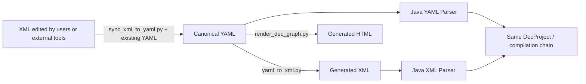

# YAML, XML, and HTML: Three Views of the Same Design

[Back to documentation home](README.md)

In the order payment Demo you will see YAML, XML, and HTML side by side. They are not three separately maintained designs, but three views of the same design for different scenarios: YAML suits editing, XML suits exchange and runtime loading, and HTML suits human reading.

## 1. Which is the source of truth and which are artifacts

| Artifact | Primary users | How it is produced or updated |
| --- | --- | --- |
| canonical YAML | designers, Skills, validators, the Java Parser | official YAML I/O, or controlled XML sync |
| generated XML | external DEC tools, the Java XML Parser, packaged applications | generated from YAML by conversion |
| generated HTML | business people, developers, reviewers | rendered from YAML |

Java's YAML/XML front ends both end up in the same `DecProject` and compilation chain. The fact that XML can be executed does not make it another authoritative source; HTML does not take part in Runtime either and cannot write back to YAML directly.



## 2. Where to find each of them in the Demo

| Path | What you will see |
| --- | --- |
| [demo/order-payment-yaml](../../demo/order-payment-yaml) | The canonical design source for order payment |
| [demo/order-payment-xml](../../demo/order-payment-xml) | The XML exported for external use |
| [application dec/design](../../demo/order-payment-app/src/main/resources/dec/design) | The XML mirror packaged with the application |
| [dec/design-files.txt](../../demo/order-payment-app/src/main/resources/dec/design-files.txt) | The resource manifest maintained by the Java generator |
| [demo/design-html](../../demo/design-html/index.html) | The reading site shared by multiple processes |
| [DEC-DESIGN-INDEX.md](../../demo/order-payment-app/DEC-DESIGN-INDEX.md) | An index of design nodes and code locations |

If you only update `demo/order-payment-xml` and forget to update the XML inside the application, the application will still execute the old design. The resource manifest only says which files are loaded; it is not responsible for generating XML content.

## 3. Generating XML and HTML from YAML

The commands are run from the repository root:

```sh
python3 skills/dec-design/scripts/validate_dec_yaml.py demo/order-payment-yaml
python3 skills/dec-design/scripts/yaml_to_xml.py demo/order-payment-yaml --check

python3 skills/dec-design/scripts/yaml_to_xml.py demo/order-payment-yaml \
  -o demo/order-payment-xml --emit-id-comments
python3 skills/dec-design/scripts/yaml_to_xml.py demo/order-payment-yaml \
  -o demo/order-payment-app/src/main/resources/dec/design --emit-id-comments

python3 skills/dec-design/scripts/render_dec_graph.py demo/order-payment-yaml \
  -o demo/design-html
```

`yaml_to_xml.py --check` only checks whether the converter can handle the design; it is not a file-by-file drift comparison between the export directory and the YAML. When you need to check the actual artifacts, regenerate them into a temporary directory and compare following the [verification manual](development-and-verification.md).

`--emit-id-comments` writes `<!-- dec-id: ... -->`, which helps the runtime front ends and renames after external editing keep identity correspondence; it does not turn the ID into an XML attribute on its own.

## 4. How to read the HTML

Start from the [site home page](../../demo/design-html/index.html) to enter a System, then drill down layer by layer into View, RuleView, API, Enum, and Information. When reading order payment for the first time, it is recommended to look at `system/order/information.html` first, then `directory/order-payment.html`.

| Page | Purpose |
| --- | --- |
| `index.html` | Design overview |
| `systems.html`, `system/<system>/index.html` | System navigation |
| `system/<system>/information.html` | Information dependency graph |
| `directories.html` | Process entries for all Businesses |
| `directory/<business>.html` | The detailed graph of a single process |
| `datasources.html` | Index of logical data sources and connections |

In the Information graph, an arrow means "what the current node depends on". The `+` beside a node expands the rule details, and `−` collapses them; the Directory graph puts stages, Action, Dependency, Produce, Change, and Back in one graph. Zooming, panning, and dragging only change how you read it, not the design.

When the presentation is wrong, fix the renderer and regenerate the whole site instead of hand-patching a single HTML page. See the [HTML generation specification](../../skills/dec-design/references/design-html-generation.md) for finer presentation conventions.

## 5. How multiple processes fit into one site

`design-html/` is a shared directory: the common pages carry no per-process prefix, and each Business lives at `directory/<business>.html`. If there are multiple processes, hand all relevant canonical inputs to the renderer in one go:

```sh
# design/flow-a and design/flow-b are example paths only.
python3 skills/dec-design/scripts/render_dec_graph.py design/flow-a design/flow-b \
  -o generated/design-html
```

Do not render flow-a first and then render flow-b separately into the same site; the second run overwrites the shared indexes. With multiple inputs, confirm there are no duplicate Design IDs before handing them to the renderer; the renderer reports normalized filename conflicts before writing, but it does not check duplicate Design IDs across inputs for you.

HTML can aggregate multiple Businesses, but a single Workflow or BusinessQuery compilation still has to state explicitly which process graph it uses.

## 6. XML initial import and later sync are not the same thing

When there is no canonical YAML yet, do the initial import first:

```sh
python3 skills/dec-design/scripts/xml_to_yaml.py external/design-xml -o imported/design-yaml
python3 skills/dec-design/scripts/validate_dec_yaml.py imported/design-yaml
```

Once YAML exists, changes made to external XML must be semantically merged with `sync_xml_to_yaml.py --existing`. Do not overwrite existing files with a full reverse import, or YAML-only metadata may be lost. See the [XML sync decision guide](xml-to-yaml-sync.md) for the specific risks; the [Skill sync specification](../../skills/dec-design/references/xml-yaml-sync.md) is authoritative for the operating steps.
