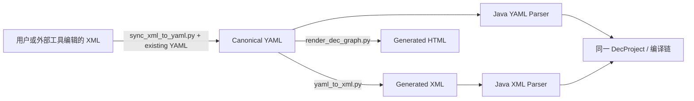

# YAML、XML 与 HTML 的关系

[返回文档总览](README.md)

## 1. 三种格式分别负责什么

| 产物 | 权威性 | 主要使用者 | 更新方式 |
| --- | --- | --- | --- |
| canonical YAML | 唯一设计源 | 设计者、Skill、Validator、Java Parser | 正式 YAML I/O 脚本；或受控 XML 同步 |
| generated XML | 派生的交换/运行时输入 | 外部 DEC 工具、Java XML Parser、打包应用 | YAML→XML 转换器 |
| generated HTML | 派生的阅读与审阅视图 | 业务人员、开发者、Reviewer | YAML→HTML 生成器 |

Java 的 YAML/XML 前端都进入同一 `DecProject` 与编译链。XML 可执行不代表 XML 是另一份权威设计源。HTML 不参与 Runtime，也不能回写 YAML。



## 2. 当前项目的产物路径

| 路径 | 说明 |
| --- | --- |
| [demo/order-payment-yaml](../demo/order-payment-yaml) | 订单支付 canonical 设计 |
| [demo/order-payment-xml](../demo/order-payment-xml) | 对外导出的 XML |
| [应用 dec/design](../demo/order-payment-app/src/main/resources/dec/design) | 随应用打包的 XML 镜像 |
| [dec/design-files.txt](../demo/order-payment-app/src/main/resources/dec/design-files.txt) | Java 生成器维护的资源清单 |
| [demo/design-html](../demo/design-html/index.html) | 多流程共享 HTML 站点 |
| [DEC-DESIGN-INDEX.md](../demo/order-payment-app/DEC-DESIGN-INDEX.md) | 设计与代码之间的索引 |

Java 生成器维护文件清单，但不代替 Python Converter 生成 XML 内容。只更新导出 XML 而未更新应用镜像，会使运行中的应用继续执行旧设计。

## 3. 从 YAML 生成 XML 和 HTML

以下命令从仓库根目录执行：

```sh
python3 skills/dec-design/scripts/validate_dec_yaml.py demo/order-payment-yaml
python3 skills/dec-design/scripts/yaml_to_xml.py demo/order-payment-yaml --check

python3 skills/dec-design/scripts/yaml_to_xml.py demo/order-payment-yaml \
  -o demo/order-payment-xml --emit-id-comments
python3 skills/dec-design/scripts/yaml_to_xml.py demo/order-payment-yaml \
  -o demo/order-payment-app/src/main/resources/dec/design --emit-id-comments

python3 skills/dec-design/scripts/render_dec_graph.py demo/order-payment-yaml \
  -o demo/design-html
```

`yaml_to_xml.py --check` 检查转换能力，不是当前 XML 与 YAML 的逐文件漂移比较。要检查漂移，应在临时目录重新生成并与目标目录比较；命令见 [验证手册](development-and-verification.md)。

`--emit-id-comments` 输出 `<!-- dec-id: ... -->`，不将 ID 擅自加入 XML 属性。它帮助运行时前端保持 ID 对应，也帮助外部编辑后的 rename 匹配。不同示例目录可能采用不同的注释快照策略；本项目订单 Demo 的导出 XML 和运行时镜像均使用该选项。

## 4. 阅读 HTML

建议从 [站点首页](../demo/design-html/index.html) 进入 System，再查看其 View、RuleView、API、Enum 和 Information。全局类型页面提供稳定的跨页引用目标。

| 页面 | 用途 |
| --- | --- |
| `index.html` | 设计总览 |
| `systems.html`、`system/<system>/index.html` | System 导航 |
| `system/<system>/information.html` | 信息依赖图 |
| `directories.html` | 所有 Business 的流程入口 |
| `directory/<business>.html` | 单个流程的详细图 |
| `datasources.html` | 逻辑数据源和连接索引 |

Information 图的箭头为“依赖者 → 被依赖者”。节点四周的 `+` 可向上、下、左、右打开不同颜色的规则详情框，并以连线连接原节点；再次点击 `−` 收起。`ruleRef` 节点展开的是对应 RuleView 的规则内容，组合节点保留其组合语义。右侧详情菜单仍可查看和跳转引用。

Directory 图区分阶段、Action、Dependency、Produce、Change 和 Back。依赖节点支持逐层展开，Change 可查看目标 Information 和变化内容，数据源信息展示流程默认、Action 覆盖及规则有效来源。图支持缩放、平移、拖动与重置。

更详细的展示约定见 [HTML 生成规范](../skills/dec-design/references/design-html-generation.md)。展示缺陷应修改生成器并重新生成，不能手工修补某一张 HTML 后把它当成长期维护源。

## 5. 多流程的组织方式

站点使用通用目录 `design-html/`，共享页面不带 `order-payment-` 前缀，每个 Business 单独生成 `directory/<business>.html`。生成多个流程时，一次传入全部相关 canonical 输入，例如：

```sh
# design/flow-a、design/flow-b 是待替换为实际项目路径的示意。
python3 skills/dec-design/scripts/render_dec_graph.py design/flow-a design/flow-b \
  -o generated/design-html
```

不要依次对同一个站点只传一个流程，否则共享索引会被最后一次输入覆盖。输入应避免重复装载相同设计 ID；Business/System 名称归一化后冲突会在写入前报错。

HTML 能汇总多个 Business，不意味着一次 Workflow/BusinessQuery 编译会自动为共享 View 选择业务流程。运行时仍需按其图编译约束明确项目/流程切片。

## 6. XML 初次导入与后续同步不同

**没有现有 canonical YAML** 时，使用初次导入：

```sh
# 路径为导入示意；输出应放在新的设计目录。
python3 skills/dec-design/scripts/xml_to_yaml.py external/design-xml -o imported/design-yaml
python3 skills/dec-design/scripts/validate_dec_yaml.py imported/design-yaml
```

初次导入优先恢复 `dec-id`，缺少时按转换规则生成 ID，之后纳入 YAML 管理。

**已经有 canonical YAML** 时，使用 `sync_xml_to_yaml.py --existing`，不能拿全量反向导入替代语义合并，否则可能丢失 YAML 独有元数据。操作步骤见 [XML 修改后同步回 YAML](xml-to-yaml-sync.md)。
